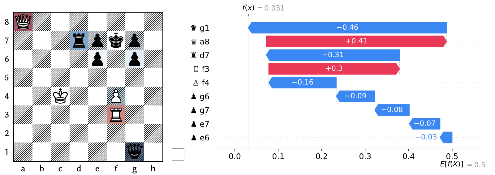

# chessplainer: explain chess positions with SHAP

**chessplainer** is a Python package for **explainable AI (XAI) in chess**. Given a position, it uses
[SHAP](https://github.com/shap/shap) (Shapley values) on top of the **Stockfish** chess engine to
measure how much each piece on the board contributes to the evaluation: which pieces push the
position towards a win for White, and which towards a win for Black.

The method is described in the paper
[Towards Piece-by-Piece Explanations for Chess Positions with SHAP](https://ceur-ws.org/Vol-4097/paper10.pdf),
presented at the AI4HGI 2025 workshop at ECAI 2025 (also on [arXiv](https://arxiv.org/abs/2510.25775)).



## How it works

1. Stockfish evaluates the original position and turns the score into win/draw/loss probabilities.
2. Pieces (kings excluded) are treated as features. SHAP's `KernelExplainer` removes subsets of
   pieces, and Stockfish re-evaluates each reduced position.
3. Each piece's Shapley value is its average contribution to White's winning chances. Values are
   shown as colored squares on an SVG board, or exported as LaTeX (`xskak`) for papers.

## Installation

```bash
pip install git+https://github.com/fspinna/chessplainer.git
```

or, from a clone of this repository:

```bash
git clone https://github.com/fspinna/chessplainer.git
cd chessplainer
pip install .
```

You also need the **Stockfish** engine: download it from the
[Stockfish website](https://stockfishchess.org/download/), or install it with your package manager
(e.g. `brew install stockfish`, `apt install stockfish`).

## Quick start

```python
import chess
from chessplainer import ChessExplainer, EngineWrapper

board = chess.Board("7k/7p/8/8/3p4/2n5/6RK/7Q w - - 0 1")

with EngineWrapper(
    path="stockfish",  # path to the Stockfish binary
    fit_limit_kwargs=dict(depth=20),  # search limit for the reported evaluation
    predict_limit_kwargs=dict(depth=12),  # search limit used inside the explanation
) as engine:
    engine.fit([board])
    explainer = ChessExplainer(
        board, engine, explainer_predict_kwargs=dict(nsamples=1000)
    )
    explanation = explainer.explain()

print(explainer.df_)  # SHAP value of each piece, one column per output
svg = explainer.to_svg()  # board colored by SHAP values (index=0: White wins)
latex = explainer.to_latex()  # same board for LaTeX, using the xskak package
```

Use `depth` (or `nodes`) limits rather than `time` limits: they make the evaluations, and so the
explanations, reproducible. Every position inside an explanation, including the original one, is
evaluated with `predict_limit_kwargs`. `nsamples` sets how many piece subsets SHAP evaluates; with
few pieces all subsets are enumerated exactly.

With the default `wdl_model="lichess"` the outputs are White's win and loss probabilities; with the
Stockfish WDL models (`"sf"`, `"sf16"`, ...) they are win, draw and loss. Use the engine as a context
manager (or call `engine.close()`) so the Stockfish process is shut down when you are done.

See [`notebooks/example.ipynb`](notebooks/example.ipynb) for a complete example. The positions from the
[paper](https://ceur-ws.org/Vol-4097/paper10.pdf) are in `chessplainer.POSITIONS`, and `board_svg(board)` draws any board in the same style as the explanations.

## Work in progress: piece interactions

Shapley values split the credit for what pieces achieve together (a queen and rook mating net, a
defender holding an attacker) evenly between them. We are working on **Shapley interactions** between
pieces, based on [shapiq](https://github.com/mmschlk/shapiq), to show which pieces work together and
which neutralize each other. The API is experimental and may change; see
[`notebooks/example_interactions.ipynb`](notebooks/example_interactions.ipynb) for a preview.

## Citation

If you use chessplainer in your research, please cite:

```bibtex
@inproceedings{spinnato2025piecebypiece,
  author    = {Spinnato, Francesco},
  title     = {Towards Piece-by-Piece Explanations for Chess Positions with {SHAP}},
  booktitle = {Proceedings of the First Workshop on Artificial Intelligence for
               Human-Game Interaction ({AI4HGI} 2025) co-located with the 28th European
               Conference on Artificial Intelligence ({ECAI} 2025)},
  editor    = {Villata, Sabrina and Rapp, Amon and Melhart, David and Barthet, Matthew
               and Preuss, Mike and Barbero, Giulio},
  series    = {{CEUR} Workshop Proceedings},
  volume    = {4097},
  publisher = {CEUR-WS.org},
  address   = {Bologna, Italy},
  year      = {2025},
  url       = {https://ceur-ws.org/Vol-4097/paper10.pdf},
}
```

The preprint is also on arXiv:
[arXiv:2510.25775](https://arxiv.org/abs/2510.25775) (doi:10.48550/arXiv.2510.25775).
